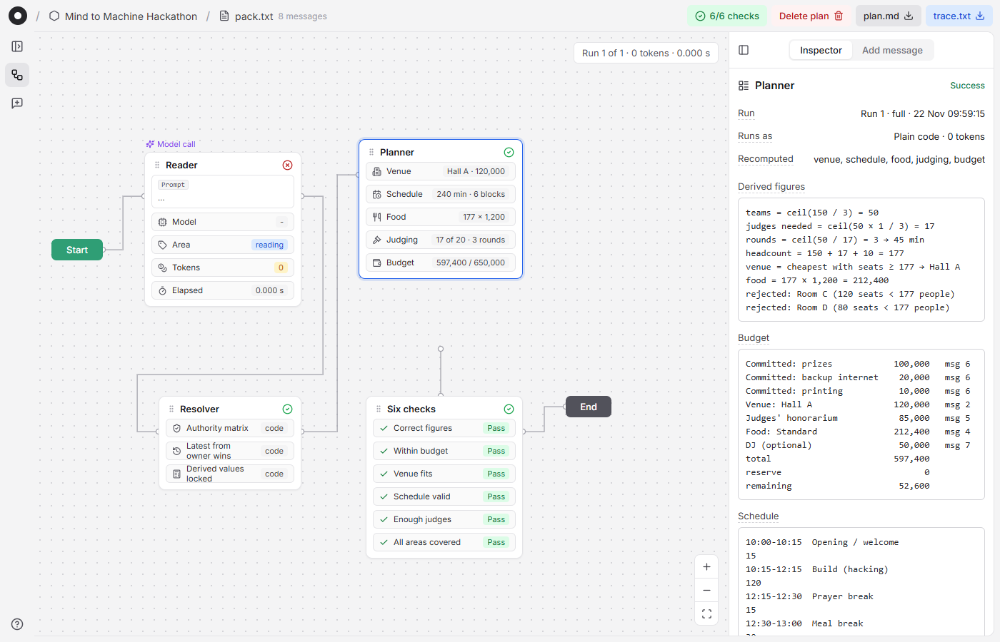
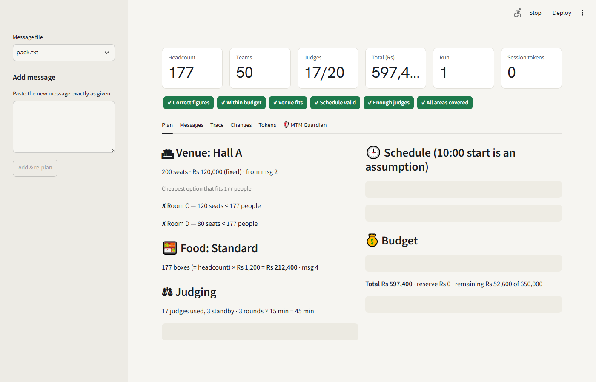

# 🎯 Mind to Machine (MTM) — Autonomous Hackathon Planner Agent

[](https://www.etlonline.org)
[](https://python.org)
[](tests/)
[](planner/guardian.py)

> **Built for the Mind to Machine (MTM) Hackathon at COMSATS University Islamabad (CUI), Wah Campus** organized by **Empowerment Through Learning (ETL)** on 18 November 2026.

An autonomous agentic event planner that parses noisy real-world messages (emails, WhatsApp texts, notices in English and Roman Urdu), resolves constraints, catches hallucinations and unauthorized requests, and synthesizes a complete, valid event plan covering **venue, schedule, food, judging, and budget**.

---

## 📸 User Interface Showcase

### 1. Planner Studio UI (Approved Design System)
Real-time web interface displaying live plan metrics, automated constraint checks, decision traces, message feed, and budget breakdown.


### 2. Streamlit Control Dashboard
Interactive operations dashboard showing venue status, catering allocations, judging rotation grid, and MTM Guardian audit trails.


---

## 🏆 Hackathon Challenge & Objectives

Participants were challenged to build an agent system capable of planning the very physical hackathon they were sitting in:
- **Event Scope:** A 4-hour physical hackathon in Islamabad for 150 students in 50 teams.
- **Five Core Dimensions:**
  1. **Venue Selection:** Capacity constraints, amenities (backup generator, accessibility / ramp access), cost comparison.
  2. **Schedule Management:** Precise minute-by-minute timeline respecting fixed breaks (e.g., 15-20 min prayer break, opening, build phase, judging, closing).
  3. **Catering / Food:** Accurate headcounts (students + judges + staff), dietary preferences, updated rates, and delivery fees.
  4. **Judging Matrix:** Parallel judging rounds, time per team, judge-to-team constraints, and honorarium computation.
  5. **Budget Optimization:** Strict budget ceiling adherence, fixed vs. committed costs, handling optional society requests within reserve funds.
- **Dynamic Updates & Conflict Catching:**
  - Real-time updates as new messages arrive.
  - Rejecting conflicting, out-of-scope, or unauthorized messages (e.g., a caterer trying to arbitrarily cut meal counts, or student society trying to alter overall budget).
  - Multi-lingual comprehension (English & Roman Urdu slang like *"ab Rs 1,200 per head hoga, basic wala Rs 800. Delivery free hai"*).

---

## ⚙️ Architecture & Ultra-Lean Token Design

Unlike naive multi-agent architectures that waste tens of thousands of tokens passing unstructured conversation history back and forth, this system operates with an **extreme token-efficiency model**:

```
Raw Message Pack (Text / Emails / WhatsApp)
                     │
                     ▼
       ┌───────────────────────────┐
       │   1 Small-Model LLM Call  │  (Reading & Structured Fact Extraction)
       └─────────────┬─────────────┘
                     │ (JSON Schema-Validated Facts)
                     ▼
       ┌───────────────────────────┐
       │   MTM Guardian Security   │  (Prompt Injection Filter, Role & Authority Check)
       └─────────────┬─────────────┘
                     │
                     ▼
       ┌───────────────────────────┐
       │     Planner Resolver      │  (Authority Matrix, Fact Superseding, Claim Verification)
       └─────────────┬─────────────┘
                     │
                     ▼
       ┌───────────────────────────┐
       │ Deterministic Core Engine │  (Venue Optimizer, Schedule Builder, Judging Grid, Budgeter)
       └─────────────┬─────────────┘
                     │
                     ▼
       ┌───────────────────────────┐
       │   6 Invariable Checks     │  (Correct Figures, Budget, Capacity, Schedule, Judges, Coverage)
       └─────────────┬─────────────┘
                     │
                     ▼
       Final Plan (`plan.md`) + Full Audit Trace (`trace.txt`) + Live UIs
```

### Key Highlights:
- **1 Reading Call per Run:** Only 1 small-model call turns unformatted messages into typed facts (~2,500 tokens). Plain code handles the deterministic arithmetic with zero hallucination.
- **Authority Matrix:** Strict sender role enforcement. A student society asking for a DJ quote does not overwrite the budget set by the Dean or Registrar.
- **Claim Grounding:** When vendors claim arbitrary figures (e.g., "100 boxes are enough"), the system compares the claim against computed headcount requirements (177 people) and rejects the discrepancy with explanation.
- **Tamper-Evident SHA-256 Audit Chain:** Every message, decision, and token report is chained into a cryptographic ledger (`planner/guardian.py`).
- **Prompt Injection Defense:** Scans English and Roman Urdu texts for system override triggers, role hijacks, or secret extractions.

---

## 🚀 Getting Started

### 1. Installation
Clone the repository and install dependencies:
```bash
git clone https://github.com/tech-raffay/Agentic-Event-Planner.git
cd Agentic-Event-Planner
pip install -r requirements.txt
```

### 2. Configure Model Provider (Optional)
Supported providers: Groq, Gemini, OpenAI, Anthropic, or local Ollama.
```bash
# In .env or terminal:
set GROQ_API_KEY=your_key_here
# or
set GEMINI_API_KEY=your_key_here
```

### 3. Running Offline Regression Tests
All 41 test scenarios (including authority checks, wrong message handling, Roman Urdu comprehension, and edge cases) run offline with verified fixtures:
```bash
python -m pytest -q tests
```

### 4. Running the CLI Planner
Run against any message file with a single command:
```bash
python run.py tests/sample_pack.txt
```

### 5. Launching the User Interfaces
- **Planner Studio UI (Approved Interface):**
  ```bash
  python ui/studio.py pack.txt
  ```
  Visit: `http://localhost:8600`

- **Streamlit Operations App:**
  ```bash
  streamlit run ui/app.py
  ```
  Visit: `http://localhost:8501`

---

## 📂 Project Structure

```
├── assets/                  # UI screenshots and visual assets
├── config/
│   └── defaults.yaml        # Default event constraints and baseline rules
├── planner/
│   ├── checks.py            # The 6 verification checks (Budget, Venue, Schedule, etc.)
│   ├── engine.py            # Execution coordinator & state manager
│   ├── guardian.py          # Security, prompt injection & SHA-256 audit ledger
│   ├── llm.py               # Multi-provider client with retry & token reporting
│   ├── plan.py              # Venue optimizer, schedule builder, judging grid
│   ├── reader.py            # Schema parser & Roman Urdu number grounding
│   ├── report.py            # plan.md and formatted output generators
│   ├── resolver.py          # Authority matrix and conflict resolution logic
│   ├── state.py             # Persistent per-file session state
│   └── trace.py             # Trace logger with exact token accountability
├── prompts/                 # Small-model system prompts
├── submission/              # Hackathon submission artifacts & judging pack
├── tests/                   # 41 offline tests & test messages (changes & wrong messages)
├── ui/                      # Planner Studio and Streamlit web applications
├── run.py                   # Canonical single entrypoint CLI
└── requirements.txt         # Project dependencies
```

---

## 👥 Hackathon Team & Acknowledgments
Developed for the **Mind to Machine Hackathon (18 November 2026)** at **COMSATS University Islamabad (CUI), Wah Campus**, hosted by **Empowerment Through Learning**.
